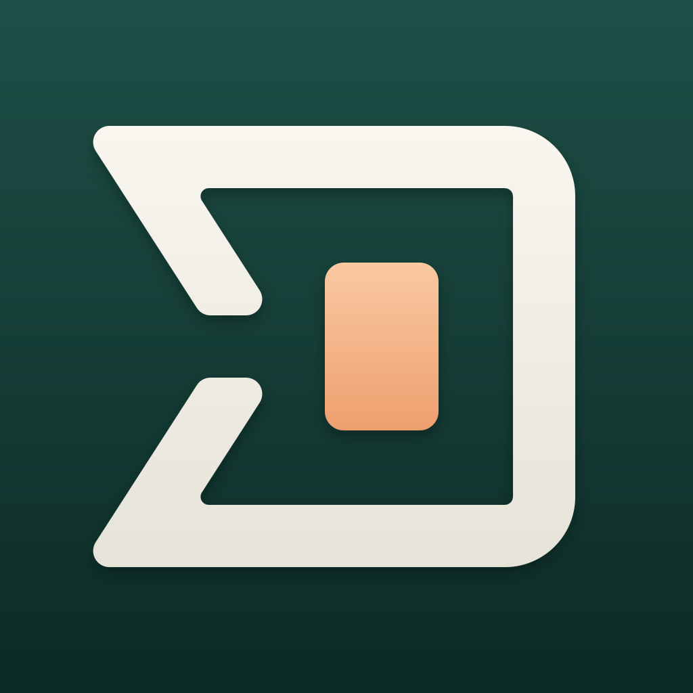

<p align="center"></p>

<h1 align="center">Hirte</h1>

<p align="center">
  Your terminals and coding agents, in your pocket.<br>
  An iPhone and iPad client for <a href="https://github.com/herdrdev/herdr">herdr</a>, made for the iPhone Duo.
</p>

<p align="center">
  <a href="https://testflight.apple.com/join/4TTMAnRM">Join the TestFlight beta</a> ·
  <a href="https://hirte.dev">Website</a> ·
  <a href="#building">Build it yourself</a>
</p>

<p align="center">
  <a href="assets/demo.mp4"></a>
</p>

Hirte ("shepherd" in German) connects to your machines over SSH and shows every terminal that
herdr-core runs there: what each agent is doing, which ones are waiting for you, and a real terminal
to jump in when they are.

- **Everything at a glance**: terminals grouped by herdr spaces and tabs, agents under the shell that
  started them, progress, and the ones that need you first
- **A real terminal**, powered by [Ghostty](https://ghostty.org)'s libghostty-vt: key bar, hardware
  keyboards, selection, links, scrollback and pinch to zoom
- **Answer in one tap**: Yes, No, Return or Esc for a blocked agent
- **Keys in the Secure Enclave**, optionally behind Face ID; host keys checked on every connect
- **Themes**: separate light and dark terminal themes, and a choice of fonts

Unfolded on the iPhone Duo, the terminal list and a terminal sit side by side. It works on every
iPhone with iOS 27.1 or later and iPad with iPadOS 27.1 or later. On iPad, the layout adapts to
resizable windows.

<p align="center">
  <picture>
    <source media="(prefers-color-scheme: dark)" srcset="assets/screenshot-dark.png">
    
  </picture>
</p>

> Hirte is an independent project. It is not affiliated with or endorsed by the herdr project; it
> speaks herdr-core's public protocol.

## Building

You need a Mac with Xcode 27, [`just`](https://github.com/casey/just),
[`xcbeautify`](https://github.com/cpisciotta/xcbeautify) and [pixi](https://pixi.sh) (for the Zig
compiler that builds libghostty-vt).

```sh
git clone --recurse-submodules https://github.com/glattziehen/hirte
cd hirte
just ghostty   # builds libghostty-vt into HerdrKit/Frameworks
just sim       # runs the app in the simulator
just test      # HerdrKit tests
```

To run it on your own iPhone, sign with your team: set `HIRTE_TEAM` and `HIRTE_BUNDLE_ID_PREFIX`
in `.envrc.local` (see `.envrc`), then `just phone`. `just` lists the other commands.

### Lokal testen

`just sim` baut Hirte Dev und startet die App im Simulator über die zu Xcode gehörende
DeviceHub-App. Standard ist „iPhone 17 Pro“; mit `HIRTE_SIMULATOR="Gerätename" just sim`
lässt sich ein anderer installierter Simulator wählen. Unter Settings → Add Demo Machine
kannst du die Oberfläche ohne SSH-Host ausprobieren. `just test` führt die HerdrKit-Tests aus.

Unter Settings → Agents → Agent Overview kannst du die Zeilenfelder mit Vorschau anpassen;
Titel und Status bleiben sichtbar, fehlende Kontextwerte werden ausgeblendet. Das zusätzliche
Menü „View and Sort“ in der Agentenübersicht bietet „Individual“ und „Nested“ sowie die
Sortierung. In Settings → Light Theme / Dark Theme findest du die Theme-Galerie; über „+“
kannst du Ghostty-Theme-Text einfügen oder eine Datei importieren und vor dem Speichern
prüfen. Die gebündelte Symbols Nerd Font Mono dient als Fallback für Nerd-Font-Symbole
im Terminal; die ausgewählte Textschrift bleibt erhalten.

Live Activities sind lokal und optional: Aktiviere unter Settings → Live Activity „Follow on
Lock Screen (Beta)“ und wähle im Terminalmenü einen arbeitenden Agenten zum Folgen aus.
Aktualisierungen erfolgen, solange Hirte geöffnet und verbunden ist; im Hintergrund oder bei
Verbindungsverlust bleibt der zuletzt bekannte Stand sichtbar. Öffne Hirte zum Aktualisieren.
Die Anzeige bietet keine verlässliche Hintergrundüberwachung.

### Optionaler Host-Kontext

Auf dem Host mit dem bestehenden herdr-core, `hc`, `git` und Python 3 kannst du den Kontext
eines freigegebenen lokalen Terminals über Labels bereitstellen:

```sh
python3 scripts/publish-context.py --terminal t7
python3 scripts/publish-context.py --terminal t7 --watch
```

Ersetze `t7` durch die lokale Terminaladresse aus `hc ls`; `--terminal` lässt sich wiederholen.
Ohne `--watch` wird einmal aktualisiert, mit `--watch` regelmäßig bis zum Abbruch mit Ctrl-C.
Die fünf Anzeigewerte sind Branch, Projekt, Verzeichnis, Agent und Account; ein zusätzlicher
Erstellungszeitstempel ordnet sie der Terminalinstanz zu. Account ist ein lesbarer Profilalias,
kein Zugangsschlüssel. Das Skript veröffentlicht keine Secrets und braucht keine Registrierung
bei GitHub. Die Labels erreichen Hirte über die bestehende Host-Verbindung; fehlende Werte
bleiben in der Übersicht ausgeblendet.

## License

Apache-2.0, see [LICENSE](LICENSE). Hirte ships Ghostty (libghostty-vt), Citadel, SwiftNIO and
other open-source code, the JetBrains Mono, Comic Mono and Symbols Nerd Font Mono fonts,
agent icon assets attributed to herdr / LobeHub, and themes from iTerm2-Color-Schemes;
their licenses and component notices are in the app under Settings → Open-Source Licenses.
Brand names and marks remain their owners' trademarks; the icon licenses do not grant
trademark rights.
